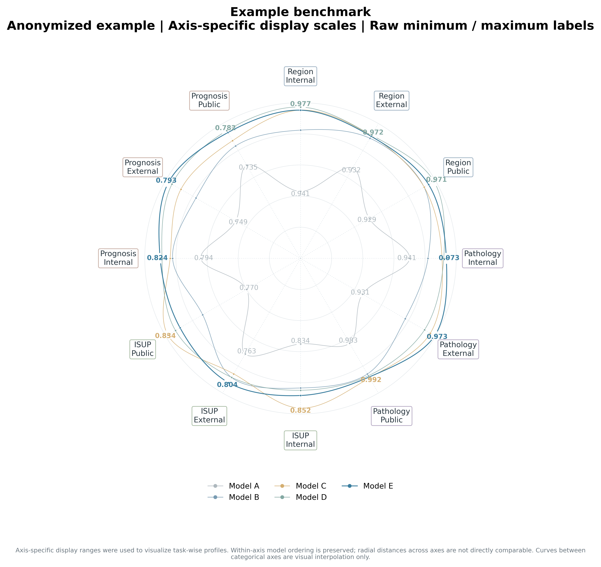

# Smooth Radar Skill

A focused Codex skill and Python renderer for publication-style smooth radar charts.

The package implements one visual style:

**Fixed, de-periodized per-axis dual anchors (`dual_anchor_custom`) + closed centripetal Catmull–Rom curves (`centripetal_catmull_rom`).**

It is designed for scientific comparisons across categorical tasks or cohorts. It preserves raw values and within-axis model ordering while providing the irregular smooth-radar contour used in the supplied example.

## Preview

The bundled example is anonymized: model identities are `Model A`–`Model E`. Numeric values, axis labels, colors, and display anchors are retained from the supplied example configuration.



## Features

- One consistent smooth-radar radar style; no alternate chart styles.
- Fixed per-axis inner/outer display anchors; no random or parity-generated anchors.
- Closed centripetal Catmull–Rom interpolation (`alpha=0.5`, 40 samples per segment by default).
- Original mapped data markers retained.
- Automatic raw minimum/maximum labels, detected before rounding.
- Three-decimal extrema labels by default; exact tie handling configurable.
- Optional local curve gaps around numeric labels without moving data points.
- Arial-first typography with Liberation Sans / DejaVu Sans fallbacks.
- Configurable model colors, task-group label boxes, line widths and optional independent Overall summary.
- PNG, SVG, PDF, and `scale_audit.json` exports.

## Install as a Codex skill

Copy this entire repository folder to your user skills directory:

**Windows**
```powershell
New-Item -ItemType Directory -Force "$HOME\.agents\skills"
Copy-Item -Recurse .\smooth-radar-skill "$HOME\.agents\skills\"
```

**macOS / Linux**
```bash
mkdir -p ~/.agents/skills
cp -R smooth-radar-skill ~/.agents/skills/
```

Install Python dependencies:
```bash
python -m pip install -r requirements.txt
```

Reload Codex. Invoke `$smooth-radar-skill` or select it from `/skills`.

For a shared project repository, place the skill under:
```text
your-project/
└── .agents/
    └── skills/
        └── smooth-radar-skill/
```

## Run the anonymized example

From this repository directory:

```bash
python scripts/plot_smooth_radar.py --config assets/example_config.json --outdir output/example
```

The output directory contains:
- `smooth_radar.png`
- `smooth_radar.svg`
- `smooth_radar.pdf`
- `scale_audit.json`

## Use your own data

1. Copy `assets/example_config.json` to your own JSON file.
2. Replace `models`, `axes`, `values`, `colors`, and `axis_groups`.
3. Supply one fixed `inner_anchor` and `outer_anchor` for each axis.
4. Set the highlight model and typography/line-width options.
5. Run:

```bash
python scripts/plot_smooth_radar.py --config my_radar.json --outdir output/my_radar
```

The `values` matrix must have shape `[number_of_models, number_of_axes]`. The two anchor arrays must each contain exactly one value per axis.

## Scientific interpretation

For axis *j*, raw values are mapped to the configured inner and outer display anchors using one shared affine transformation across models on that axis.

Consequences:
- Raw measurements are not changed.
- Within-axis ordering and ties are preserved.
- Radial distances across different axes are **not directly comparable**.
- Radar polygon area must **not** be interpreted as an overall score or used to rank models.

Use the following caption note (or equivalent):

> Axis-specific display ranges were used to visualize task-wise profiles. Within-axis model ordering is preserved; radial distances across axes are not directly comparable. Curves between categorical axes are visual interpolation only.

Preserve the raw values in the source table and retain `scale_audit.json` with the exact anchors and mapped radii.

## Typography

Arial is the default preferred font. If Arial is unavailable, Matplotlib falls back to Liberation Sans and then DejaVu Sans. For exact manuscript typography, install Arial on the rendering machine.

## License

MIT. See [LICENSE](LICENSE).

## Data-release note

The example replaces model names with Model A–E but retains the supplied numeric values, axis labels, colors, and anchor settings. Confirm that these results are approved for public release before publishing this repository. Model-name replacement alone does not anonymize experimental results.

## Development and tests

```bash
python -m pip install -r requirements-dev.txt
pytest -q tests
```

GitHub Actions runs the tests and renders the anonymized example on pushes and pull requests.
